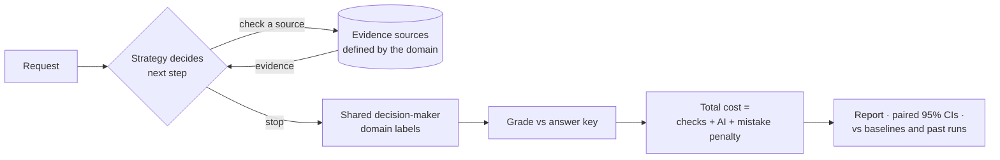

<div align="center">

# Yantraa Evidence

**Does checking less evidence make AI decisions cheaper, without making them worse?**

A Python package for measuring whether an AI that *chooses which records to check* can make decisions
at a lower total cost than checking everything. It works for any domain: returns, claims, disputes, alerts or approvals.


</div>

---

## Contents

[What is this?](#what-is-this) · [Who it's for](#who-its-for) · [Install and run](#install-and-run) ·
[1. Overview](#1-overview) · [2. Experiment](#2-experiment) · [3. Evaluate](#3-evaluate) ·
[Bring your own domain](#bring-your-own-domain) · [Configuration](#configuration) · [Architecture](#architecture) ·
[Development](#development) · [Privacy & security](#privacy--security) · [Limitations](#limitations) · [License](#license)

---

## What is this?

Before an AI approves, denies or escalates something, it usually needs to check records. **Every check costs money and
time, and every wrong decision costs more.** Checking everything is safe but wasteful. Checking nothing is cheap but
reckless. Yantraa Evidence gives you a controlled way to find the middle ground and to *prove* it with numbers.

You get three building blocks. Use them from Python, a notebook or the CLI, and build any app you like on top:

| Step | What you do | Python | CLI |
|---|---|---|---|
| **1. Overview** | See the domain, evidence sources and costs, strategies, decision-makers, data and saved results | `overview()` | `yantraa overview` |
| **2. Experiment** | Design and run a comparison: domain, cases, strategies, decision-maker, your costs and limits | `Experiment(...).run()` | `yantraa experiment` |
| **3. Evaluate** | Score it against benchmark baselines and earlier experiments, with paired 95% intervals | `evaluate(...)`, `compare_to_baseline(...)` | `yantraa evaluate` |



**Built-in guarantees:**

- 🔒 **Strict information boundary.** The decision-maker sees only what has been fetched, never the answer key or unfetched records. Tests enforce this.
- ⚖️ **Fair comparison.** Every strategy shares the same decision-maker, instructions and limits.
- 🧯 **Fails safe and loudly.** Limits are checked *before* each call. Any failure returns the domain's fallback label (for example *escalate*) with the reason recorded. There are no silent retries.
- 📏 **Honest statistics.** Paired, seeded bootstrap intervals and penalty-sensitivity analysis. Unknown prices are reported as *unknown*, never as zero.
- 🧾 **Reproducible.** Every run stores its config hash, seed, data and prompt versions, model version and full trace.

## Who it's for

| Industry | Example decision | Labels (fallback in bold) |
|---|---|---|
| Retail / e-commerce *(built in)* | Approve a product return | approve, reject, **escalate** |
| Insurance *(example included)* | Triage a property claim | pay, deny, **refer** |
| Banking / fintech | Resolve a chargeback, clear an AML/KYC alert | accept, reject, **review** |
| Lending | Approve a loan exception | approve, decline, **manual underwriting** |
| Healthcare administration | Prior-authorization review | approve, deny, **clinician review** |
| Telecom / SaaS | Billing dispute credit | credit, decline, **escalate** |
| Logistics | Delivery exception claim | reimburse, deny, **investigate** |
| IT / security operations | Access request or alert triage | grant, deny, **escalate** |

| If you are… | It helps you… |
|---|---|
| **An AI / ML engineer** | Benchmark an agent's *retrieval policy*, not just its answers, and trace every failure step by step. |
| **A product or ops lead** | Enter what checks and mistakes cost *your* business and see whether a strategy still wins. |
| **A risk / compliance officer** | Verify fallback behaviour, mistakes by label and which evidence supported each decision. |
| **A researcher** | Start from a seeded, reproducible test bed with locked held-out data and exportable traces. |
| **An app developer** | Build a review console, dashboard or service on plain Python objects, SQLite and CSV/JSONL. |

More detail, with evidence sources and mistake costs for each industry: [docs/use-cases.md](https://github.com/Shalihotri/Yantraa/blob/main/docs/use-cases.md).

## Install and run

**Prerequisites:** Python 3.11 or newer, plus [uv](https://docs.astral.sh/uv/getting-started/installation/)
(recommended) or `pip`. No API key is needed: the built-in mock decision-maker is free and offline.

**Install from PyPI** (run the commands from the folder where you want data and results kept):

```bash
# With pip (inside a virtual environment)
pip install yantraa-evidence
yantraa overview

# With uv, as a dependency of your own project
uv add yantraa-evidence
uv run yantraa overview

# With uv, as a standalone tool (no project needed)
uv tool install yantraa-evidence     # or try it once: uvx --from yantraa-evidence yantraa overview
yantraa overview
```

Then continue with `yantraa experiment` and `yantraa evaluate` (see step 2 below), or `import yantraa_evidence` in
Python.

**From a source checkout** (to change the code or run the tests):

1. Get the code and install it:

   ```bash
   git clone https://github.com/Shalihotri/Yantraa.git
   cd Yantraa
   uv sync
   ```

2. Run the three steps:

   ```bash
   uv run yantraa overview                  # what's available
   uv run yantraa experiment --limit 40     # run all strategies on 40 synthetic cases (data is generated on first run)
   uv run yantraa evaluate                  # report the latest experiment against the fetch_all baseline
   ```

3. Or run the same flow from Python: `uv run python examples/quickstart.py`

4. *(Optional, for a real AI)* copy `.env.example` to `.env` and set `OPENAI_API_KEY=...`. Then add
   `--provider openai` to an experiment. **Always check the spend first** with `--estimate-only`.

**Source checkout without uv:** `python -m venv .venv`, activate it, then run `pip install -e .`. After that, use
`yantraa ...`.

**Real AI with a pip install:** put a `.env` file containing `OPENAI_API_KEY=...` in the folder you run `yantraa`
from, or set the variable in your shell.

## 1. Overview

```python
from yantraa_evidence import overview
from yantraa_evidence.overview import to_text

info = overview()            # plain dict: domain, sources & costs, strategies, providers, data, saved results
print(to_text(info))
```

`yantraa overview` prints the same information. Add `--json` for machine-readable output, or `--problems 20` for the
latest logged failures.

## 2. Experiment

```python
from yantraa_evidence import Experiment

exp = Experiment(
    domain="returns",                    # or "my_pkg.domains:CLAIMS" or "path/file.py:DOMAIN"
    split="dev",                         # tune on dev; keep test locked until the end
    strategies=["selective", "fixed_order", "fetch_all"],
    provider="mock",                     # "openai" (Decisions API) or "openai-responses"
    limit=40,
    overrides={"costs": {"get_inspection": 0.25}, "loss": {"approve": 50}},  # your economics
)
print(exp.estimate())                    # worst-case calls and spend, before anything runs
result = exp.run()                       # scored, saved to SQLite, exported to CSV / JSONL / JSON
trace = exp.run_case(0, "selective")     # one decision, fully traced
```

**Built-in strategies:** `selective` (the AI picks the next check: the idea being tested), `fetch_all` (reference
baseline), `fixed_order` (checklist, stop early), `confidence_threshold` (stop when the AI is sure) and `initial_only`
(no checks: the lower bound).

**Add your own strategy** in a few lines. It is then available to `Experiment` and the CLI:

```python
from yantraa_evidence import register_strategy

@register_strategy
def cheapest_first(s):
    """Check sources from cheapest to most expensive; stop once the decision is no longer the fallback."""
    d = s.classify()
    for src in sorted(s.sources, key=lambda x: s.cfg.sources[x].cost):
        if d.action != s.domain.fallback:
            break
        s.fetch(src)
        d = s.classify()
    return d
```

**CLI:**

```bash
yantraa experiment --split dev --strategies selective,fetch_all --limit 40
yantraa experiment --provider openai --limit 10 --estimate-only
yantraa experiment --case 0 --strategies selective        # one traced decision
yantraa experiment --generate --seed 7                    # regenerate synthetic cases
```

## 3. Evaluate

```python
from yantraa_evidence import evaluate, compare_to_baseline

report = evaluate(result)                 # or evaluate("b_2026...") for a saved experiment
print(report.to_text())                   # headline, scoreboard, paired verdicts vs fetch_all, caveats
report.metrics                            # accuracy, wrong_<label>, fallback_rate, checks, costs, latency
report.paired_comparisons                 # each strategy minus the baseline, with 95% intervals
report.penalty_sensitivity                # does the winner change if mistakes cost 0.25x to 4x?
report.accuracy_by_scenario, report.mistakes

compare_to_baseline(new_result, "b_2026...")   # new prompt / model / costs vs a saved benchmark, paired by case
```

**CLI:**

```bash
yantraa evaluate                          # latest experiment
yantraa evaluate --list                   # saved experiments
yantraa evaluate b_NEW --against b_OLD    # regression check against an earlier benchmark
yantraa evaluate --reference fixed_order --json
```

Every report repeats its caveats: synthetic data, assumed penalties, mock ≠ model quality, confidence ≠ calibration.

## Bring your own domain

A domain is one class. Declare the sources, labels, fallback and penalties, then implement `assess`. That one
function produces the answer key and drives the offline mock, so the two can never disagree.

```python
from yantraa_evidence import Assessment, Domain, Source

class Chargebacks(Domain):
    name = "chargebacks"
    task = "Decide whether to accept a card chargeback."
    sources = (Source("get_transaction", "Transaction log", cost=0.01),
               Source("get_merchant_evidence", "Merchant's delivery proof", cost=0.20),
               Source("get_customer_history", "Prior disputes", cost=0.05))
    actions = {"accept": "...", "reject": "...", "review": "..."}
    fallback = "review"
    loss = {"accept": 80, "reject": 30, "review": 3}

    def assess(self, evidence):           # evidence = {source_id: [payload, ...]} for fetched sources
        ...
        return Assessment(action, conditions)
```

To use it, pass `Experiment(domain="my_module:Chargebacks")` or `--domain path/to/file.py:DOMAIN`. Alternatively, call
`register_domain(Chargebacks())`.

- **Data:** implement `generate(seed)` for synthetic cases, or write your own `Case` records (with the correct answer
  in `oracle_action`) to `data/<domain>/<split>.jsonl`. You can also pass `Experiment(cases=[...])`.
- **Full worked example:** [examples/insurance_claims.py](https://github.com/Shalihotri/Yantraa/blob/main/examples/insurance_claims.py) covers claims triage with a
  generator, and runs in CI.
- **Another model:** implement `select(obs)` and `classify(obs)`, then pass `Experiment(adapter_factory=...)`.

## Configuration

| What | Where |
|---|---|
| API key and model overrides | `.env` (copy [`.env.example`](https://github.com/Shalihotri/Yantraa/blob/main/.env.example)). It is git-ignored. |
| Domain, source costs, mistake penalties, limits, threshold, paths | [`config/default.yaml`](https://github.com/Shalihotri/Yantraa/blob/main/config/default.yaml), or `Experiment(overrides=...)` per run |
| Model prices (USD per 1M tokens) | [`config/pricing.yaml`](https://github.com/Shalihotri/Yantraa/blob/main/config/pricing.yaml). Missing prices are reported as *unknown*. |

Unknown source or label names in config fail loudly instead of being ignored.

## Architecture

```
src/yantraa_evidence/
  overview.py      1. what is available (domains, strategies, providers, data, results)
  experiment.py    2. Experiment / ExperimentResult: design, estimate, run, save
  evaluate.py      3. scoring, metrics, paired bootstrap, sensitivity, Report, compare_to_baseline
  domain.py        Domain / Source / Assessment base classes and the domain registry
  domains/         built-in domains (returns: retail product returns, with a seeded generator)
  strategies.py    built-in strategies + @register_strategy
  adapters.py      decision-makers: mock (offline) and OpenAI (Decisions, Responses)
  runner.py        guarded execution engine: Session, limits, validation, tracing
  tools.py         case-data-backed evidence tools (same interface a live connector would use)
  datasets.py      case files (JSONL) and synthetic data generation
  storage.py       SQLite results + evidence graph, CSV/JSONL/JSON export
  schemas.py       typed contracts: Case, Observation, decisions, RunResult
  config.py        YAML config, domain defaults, pricing, .env
  logtracker.py    structured "what went wrong" log (keys redacted)
  cli.py           `yantraa overview | experiment | evaluate`
examples/          quickstart.py · insurance_claims.py (custom domain)
docs/              design.md (method, guarantees, findings log) · use-cases.md (industries and personas)
tests/             isolation, limits, failures, graph round-trip, known answers, custom domains, CLI
```

Read [docs/design.md](https://github.com/Shalihotri/Yantraa/blob/main/docs/design.md) before citing a result.

## Development

```bash
uv sync                                    # Python env with dev tools
uv run pytest                              # all tests, offline, no API key
uv run ruff check src tests examples       # lint
uv build                                   # wheel + sdist in dist/
```

CI ([`.github/workflows/ci.yml`](https://github.com/Shalihotri/Yantraa/blob/main/.github/workflows/ci.yml)) runs lint and tests on Linux and Windows with Python 3.11
and 3.12. It also runs the Overview → Experiment → Evaluate flow offline for both domains, a wheel-install smoke test
and a secret scan. See [CONTRIBUTING.md](https://github.com/Shalihotri/Yantraa/blob/main/CONTRIBUTING.md).

## Privacy & security

- **Everything runs locally.** There is no server, no account and no telemetry.
- **Your API key stays on your machine.** It is read from the environment or `.env`, and it is never logged or
  stored. Provider error messages are redacted before logging. `.env`, databases, logs and results are git-ignored.
- **Only live decision-makers send data out.** With `--provider openai`, the fetched evidence for each case goes to
  OpenAI (`store=False` where the API allows). The mock sends nothing.
- **Bundled data is synthetic.** It contains no real people, orders or personal information. If you use real
  records, anonymise them first and keep them in a git-ignored folder (for example `private/`).

## Limitations

- Synthetic data is balanced for debugging. It is **not** a production distribution.
- Default mistake penalties are illustrative. Set your own, and read the sensitivity table.
- The mock uses the same rule as the answer key: it validates mechanics, not model quality.
- An AI's stated confidence is not calibrated correctness. The tool supports comparisons, not causal claims.
- Live results so far are small-sample. See the [findings log](https://github.com/Shalihotri/Yantraa/blob/main/docs/design.md#findings-log).

## Roadmap

- [ ] More built-in domains (chargebacks, access requests) and adapters for other model providers
- [ ] Live evidence connectors behind the same tool interface
- [ ] Larger live runs on the practice set, then a single locked run on the held-out set
- [ ] External validation on real, anonymised decision logs

## Contributing

Issues and pull requests are welcome. Please read [CONTRIBUTING.md](https://github.com/Shalihotri/Yantraa/blob/main/CONTRIBUTING.md). In short: keep the information
boundary intact, add tests, and keep negative findings visible.

## License

[Apache-2.0](https://github.com/Shalihotri/Yantraa/blob/main/LICENSE).
